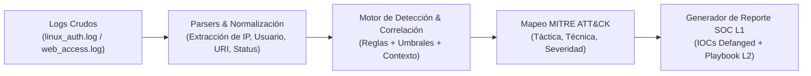

# 🛡️ SOC L1 Mini-SIEM & Log Triage Engine (MITRE ATT&CK)


Motor ligero de análisis de logs, correlación de eventos y generación automatizada de reportes de triaje diseñado para simular el flujo real de trabajo de un **Analista de Ciberseguridad SOC Nivel 1 (Tier 1)**.

---

## 🎯 Objetivo del Proyecto (Perspectiva SOC L1)

En un **Security Operations Center (SOC)**, el analista Nivel 1 es la primera línea de defensa. Sus responsabilidades principales son:
1. **Monitorear y analizar logs** de autenticación (`auth.log`) y servidores web (`access.log`).
2. **Distinguir Falsos Positivos (FP) de Verdaderos Positivos (TP)** analizando el contexto (ej. códigos de respuesta HTTP `200 OK` vs `404/403`, o múltiples intentos fallidos seguidos de un inicio de sesión exitoso).
3. **Mapear alertas al framework MITRE ATT&CK** para clasificar la táctica y técnica del adversario.
4. **Aplicar Defanging a los IOCs** (`185.220.101[.]45`) para evitar clics accidentales y **documentar el ticket de escalado a SOC L2**.

---

## 🏗️ Arquitectura del Flujo de Triaje



---

## 🗺️ Matriz de Detección MITRE ATT&CK Implementada

| ID Regla | Amenaza Detectada | Fuente de Log | Táctica MITRE | Técnica MITRE | Severidad |
| :--- | :--- | :--- | :--- | :--- | :--- |
| `SOC-SSH-001` | **SSH Brute Force Attack** | `linux_auth.log` | Credential Access | `T1110.001` - Password Guessing | `MEDIUM` |
| `SOC-SSH-002` | **SSH Password Spraying** | `linux_auth.log` | Credential Access | `T1110.003` - Password Spraying | `HIGH` |
| `SOC-SSH-003` | **Account Compromise Post-Brute Force** | `linux_auth.log` | Initial Access / Persistence | `T1078` - Valid Accounts | `CRITICAL` |
| `SOC-WEB-001` | **Automated Vulnerability Scanning (Nikto/Nmap/Sqlmap)** | `web_access.log` | Reconnaissance | `T1595.002` - Vulnerability Scanning | `LOW` / `MEDIUM` |
| `SOC-WEB-002` | **SQL Injection (SQLi) Attempt / Exploitation** | `web_access.log` | Initial Access | `T1190` - Exploit Public-Facing Application | `HIGH` / `CRITICAL` |
| `SOC-WEB-003` | **Path Traversal / Local File Inclusion (LFI)** | `web_access.log` | Initial Access / Collection | `T1190` / `T1083` - File and Directory Discovery | `HIGH` / `CRITICAL` |
| `SOC-WEB-004` | **Cross-Site Scripting (XSS) Payload** | `web_access.log` | Initial Access | `T1189` - Drive-by Compromise | `MEDIUM` |
| `SOC-WEB-005` | **OS Command Injection (RCE Attempt)** | `web_access.log` | Execution | `T1059.004` - Unix Shell | `CRITICAL` |

---

## 📂 Estructura del Proyecto

```text
soc-l1-log-analyzer-siem/
├── logs/
│   ├── linux_auth.log          # Dataset realista de eventos SSH y PAM en Linux
│   └── web_access.log          # Dataset realista de peticiones HTTP (Nginx/Apache)
├── src/
│   ├── __init__.py
│   ├── parsers.py              # Normalización de logs crudos con Regex
│   ├── detector.py             # Motor de reglas y correlación mapeado a MITRE ATT&CK
│   └── reporter.py             # Defanging de IOCs y generador de reporte de incidente
├── playbooks/
│   └── SOC_L1_Playbook.md      # Guía operativa de respuesta y escalado para el analista
├── reports/                    # Reportes de triaje generados automáticamente (Markdown/JSON)
├── tests/                      # Pruebas unitarias de parsers y reglas de detección
├── main.py                     # CLI principal de ejecución del Mini-SIEM
└── README.md
```

---

## 👤 Autor

* **Gabriel Martínez** ([@GabrielMartinez97](https://github.com/GabrielMartinez97)) — *Cybersecurity SOC L1 Portfolio*
