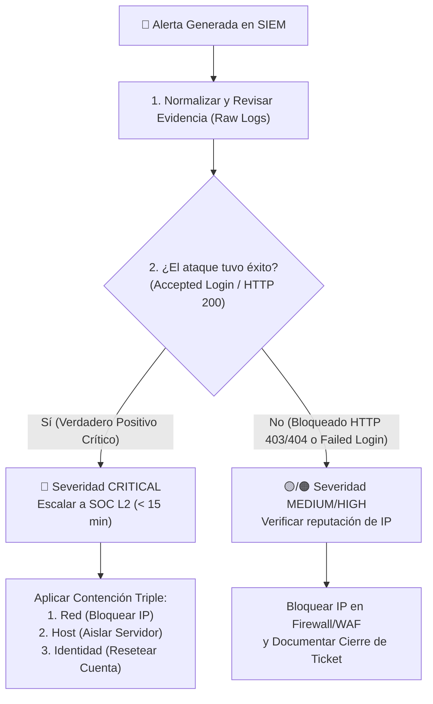

# 📘 Playbook Operativo de Triaje y Respuesta — SOC Nivel 1

Este documento define el procedimiento estándar (**SOP / Playbook**) que debe seguir el **Analista SOC Nivel 1 (Tier 1)** cuando el motor del Mini-SIEM genera una alerta.

---

## 🔄 Diagrama de Flujo de Triaje SOC L1

---

## 🛡️ La Regla de Oro de Contención: Modelo "Red + Host + Identidad"

Cuando se confirma un compromiso real (como `SOC-SSH-003` o `SOC-WEB-002` con `HTTP 200`), bloquear solo la IP no es suficiente porque el atacante puede cambiar de IP usando una VPN o proxy. Siempre se solicita contención en **3 capas**:

1. **🌐 Capa de Red (Network):**
   * Bloquear la IP atacante (aplicando *defanging* en el ticket, ej. `185.220.101[.]45`) en el Firewall perimetral o WAF.
2. **💻 Capa de Host / Endpoint (Aislamiento):**
   * Aislar preventivamente el servidor afectado (`prod-bastion-01`) mediante el EDR y terminar los procesos o sesiones SSH activas del atacante.
3. **🔑 Capa de Identidad (Credenciales):**
   * Deshabilitar temporalmente el usuario comprometido (`backup_svc`), forzar el cambio inmediato de contraseña y auditar si el atacante agregó llaves SSH (`~/.ssh/authorized_keys`) para mantener persistencia.

---

## 📋 Guías Rápidas por Caso de Uso

### Caso 1: Fuerza Bruta SSH y Compromiso de Cuenta (`T1110` / `T1078`)
* **Qué mirar en el log:** Conteo de `Failed password`, puertos secuenciales (uso de Hydra/Medusa) y si existe algún `Accepted password` posterior desde la misma IP.
* **Criterio de Escalado:**
  * Solo `Failed password` -> **MEDIUM / HIGH**: Solicitar bloqueo de IP en Fail2Ban/Firewall.
  * `Failed password` seguido de `Accepted password` -> **CRITICAL**: Escalar a SOC Nivel 2 inmediatamente aplicando contención **Red + Host + Identidad**.

### Caso 2: Ataques Web — SQL Injection, Path Traversal y RCE (`T1190` / `T1083` / `T1059`)
* **Qué mirar en el log:**
  1. Payload decodificado (`UNION SELECT`, `../../../../etc/passwd`, `;cat /etc/passwd|nc`).
  2. **Código de Estado HTTP (`200` vs `403`/`404`/`500`)**.
  3. **Tamaño de respuesta en Bytes** (un `HTTP 200` con miles de bytes en un SQLi confirma exfiltración de datos).
* **Criterio de Escalado:**
  * Código `403` o `404` -> El ataque fue mitigado. Bloquear IP en WAF.
  * Código `200 OK` -> **CRITICAL**: Posible brecha de datos o lectura de archivos del sistema. Escalar a SOC L2 y equipo de Desarrollo/AppSec.
